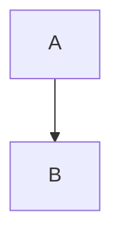

# 节点逐项手工验收清单

覆盖原审查报告 B001–B089：12 项 P1、74 项 P2、3 项 P3。每项均列出材料、步骤和通过标准；所有手工结果初始为未验证。B089 已由 P2 的共享任务列表修复覆盖，仍保留独立验收项。

## 开始前

- 使用包含本次修复的新构建。记录系统、应用版本或 Git 提交、主题、输入法，以及“精细排版”“行内代码渲染”“复制 Markdown 语法”等相关开关。
- 建一个可丢弃的测试目录，每个用例使用独立文件副本。准备 assets/a.png、assets/a).png、assets/my image.png、assets/b.png 测试图片；B005 的资源删除只针对该目录中的测试副本。
- 下面标为 Markdown 的样例，粘贴到源码视图后切换语义视图；标为 HTML 剪贴板的内容，需要从富文本来源复制或请研发提供 text/html 剪贴板，不能把 HTML 字符串当普通文本粘贴来替代该路径。
- 按每项步骤先检查即时行为，再执行“保存 → 关闭该文件 → 重开”。涉及修改的项同时检查撤销/重做，以及前后 KEEP 段落、其它格或其它列表项是否保留。
- Windows/Linux 的 Ctrl 快捷键在 macOS 通常对应 Cmd；以当前应用实际快捷键为准。
- 异步首次渲染、正在加载时导出、运行时切只读、悬浮中更新及毫秒级 IME 时序，可能需要研发在测试宿主控制对应 Promise 或调用已列出的 EditorCore API。界面不能稳定触发时填“需协助”，不要按没有观察到问题勾选通过。
- 勾选用例表示已由你实际操作并通过全部标准；失败或未覆盖的分支写在“实际结果”处。当前文档本身不表示真实 UI、系统输入法或磁盘导出已经通过。

记录：系统 ________；构建/提交 ________；主题 ________；输入法 ________；开关 ________；测试人 ________；日期 ________。

## P1：内容保留、资源与安全边界

### B001 · 导出清理删除完整代码块和目录

- [ ] B001 全部分支手工验收通过

材料（Markdown / HTML 源码）：

~~~~~text
```js
const FIRST = 1;
const LAST = 2;
```

<!-- toc -->
- [标题](#标题)
<!-- /toc -->

# 标题
~~~~~

1. 编辑代码块后保持编辑框打开，分别导出 HTML 和 PDF。
2. 再用一段至少 100 行的代码，滚动到末尾、选中代码节点后再次导出。

通过标准：导出保留全部代码首尾及目录正文；无输入框、按钮、选区边框、重复行号；PDF 实际页面内容与 HTML 一致。

实际结果 / 未覆盖分支：________

### B002 · 全文图片预处理改写代码与注释字面内容

- [ ] B002 全部分支手工验收通过

材料（Markdown / HTML 源码）：

~~~~~text
```html

```

``

<!--

-->
~~~~~

1. 在其它正文输入一个字符，保存并重开。
2. 分别把上述字面内容放进引用、列表和缩进代码，再保存。

通过标准：代码、行内代码、注释中的 img 源码保持字面内容，不变成图片 Markdown；正常正文图片仍可显示。

实际结果 / 未覆盖分支：________

### B003 · 多行节点序列化丢失引用前缀和列表缩进

- [ ] B003 全部分支手工验收通过

材料（Markdown / HTML 源码）：

~~~~~text
> ```mermaid
> graph TD
> A-->B
> ```
>
> <!--
> COMMENT
> -->
>
> $$
> a+b
>
> c+d
> $$
~~~~~

1. 在引用内分别放入图表、块注释、表格、HTML 块、块公式和 TOC，编辑旁边正文并保存重开。
2. 在无序列表、有序列表及嵌套列表中重复这 6 类节点；每个节点前后各放 KEEP 段落。

通过标准：六类节点的全部行保持在原容器中；无截断、重复前缀、节点降级或 KEEP 丢失；公式空行和缩进保留。

实际结果 / 未覆盖分支：________

### B004 · 容器内输入块公式会删除整个列表、引用或表格

- [ ] B004 全部分支手工验收通过

材料（Markdown / HTML 源码）：

~~~~~text
- kept
- $$
- also kept

> kept
>
> $$
>
> also kept

| A | B |
| --- | --- |
| $$ | KEEP |
~~~~~

1. 把光标放在列表、引用的 $$ 后按 Enter。
2. 在表格中的 $$ 后也按 Enter，检查相邻 KEEP 单元格；另在正文直接输入 $$ 后按 Enter。

通过标准：只处理当前段落，保留其它列表项、引用段落和整张表格；容器不支持块公式时使用正常 Enter 行为；正文正常转换。

实际结果 / 未覆盖分支：________

### B005 · 源码图片引用判定误触发磁盘资源删除

- [ ] B005 全部分支手工验收通过

准备：

1. 仅在专用测试目录放一张可丢弃图片，并启用自动删除未引用本地图片；先保存引用它的测试文档。
2. 源码中依次改成 、、等价 ./assets/a.png 路径，每次保存重开。
3. 保持其中一个有效引用，再删除另一个引用；最后真正删除全部引用，核对原有资源清理行为。

通过标准：前几步仍有引用时图片文件一直存在、重开正常；仅最后无引用的正控可按原设置清理测试图片；不要使用真实资料图片。

实际结果 / 未覆盖分支：________

### B006 · 提示框 API 定位错误导致正文删除或属性覆盖

- [ ] B006 全部分支手工验收通过

材料（Markdown / HTML 源码）：

~~~~~text
> [!NOTE]
> FIRST
>
> SECOND
>
> ### H3

SAFE TEXT
~~~~~

1. 在 SECOND 或 H3 内切换提示框类型，覆盖 NOTE、TIP、IMPORTANT、WARNING、CAUTION。
2. 再取消提示框，随后撤销、重做；若当前界面没有对应操作，请研发在测试宿主调用 toggleCalloutType / unwrapCallout。

通过标准：FIRST、SECOND、H3、SAFE TEXT 不删、不重、不乱序；只改变提示框类型或展开提示框；H3 级别保持。

实际结果 / 未覆盖分支：________

### B007 · 控制字符绕过链接脚本协议过滤

- [ ] B007 全部分支手工验收通过

材料（Markdown / HTML 源码）：

~~~~~text
x<a href="java&#9;script:void(0)" id="t"></a>y

<a href="java&#10;script:void(0)">label</a>

<a href="java&#13;script:void(0)">label</a>
~~~~~

1. 按 Markdown 打开三种实体变体；另通过 HTML 剪贴板粘贴同样内容。
2. 导出 HTML，用文本查看 href，再用普通 https 链接和 #t 链接作对照；无需点击危险地址。

通过标准：解析、粘贴、显示、导出均不生成可执行的 javascript 协议链接；正常链接和安全锚点仍保留。

实际结果 / 未覆盖分支：________

### B008 · HTML 回退渲染绕过危险内容过滤

- [ ] B008 全部分支手工验收通过

材料（Markdown / HTML 源码）：

~~~~~text
<div><a href="javascript:void(0)">click</a></div>

<div onclick="void(0)">plain</div>

<iframe srcdoc="<p>probe</p>"></iframe>
~~~~~

1. 从 Markdown 打开样例，检查显示及导出 HTML 源码；覆盖带 style、事件属性和 object data 的 HTML 回退内容。
2. 使用含普通链接、图片、格式和合并表格的安全 HTML 作对照。

通过标准：回退显示不注入危险 URL、事件、srcdoc 或危险嵌入内容；无法安全展示的结构显示字面原文；安全内容的正文及结构保留。

实际结果 / 未覆盖分支：________

### B009 · 切换任务列表定位错误并删除正文

- [ ] B009 全部分支手工验收通过

材料（Markdown / HTML 源码）：

~~~~~text
- [ ] a $x$ tail
- [ ] first

  second

- $x$ tail
~~~~~

1. 对第一项切换任务列表及取消列表，对 second 所在项重复；在公式开头的普通项上启用任务列表。
2. 在任务项末尾按 Enter；撤销、重做并保存重开。

通过标准：tail、second 不缺字；新任务标记在首段开头、公式之前；续行状态正确，后续段落和嵌套内容保留。

实际结果 / 未覆盖分支：________

### B010 · 标题内容规则拒绝新增行内节点并丢弃整个标题

- [ ] B010 全部分支手工验收通过

材料（Markdown / HTML 源码）：

~~~~~text
# Title $x$[^1] <!-- note --> <a id="anchor"></a><br>continued

[^1]: 说明

body
~~~~~

1. 覆盖 H1–H6，并单独测试 Setext 标题 Title / continued / ===；只修改 body，保存重开。
2. 把含公式、脚注、注释、锚点或换行的普通段落转换成标题，再撤销、重做。

通过标准：标题及其全部行内内容保留；不丢整标题或公式；保存重开后标题级别、软/硬换行及正文一致。

实际结果 / 未覆盖分支：________

### B011 · 表格尺寸命令静默截断已有行列

- [ ] B011 全部分支手工验收通过

准备：准备首行 H、其后 R1–R20 的 21×1 表格；再准备包含 C1–C13 的 2×13 表格。

1. 尺寸面板选择已有原尺寸；分别只增加或调整另一维。
2. 最后明确选择缩小某一维，检查只删除用户请求缩小的部分，撤销后恢复。

通过标准：选择原尺寸不截断；21 行、13 列的旧内容在未要求缩小时保留；另一维调整不连带丢失尾行尾列。

实际结果 / 未覆盖分支：________

### B012 · 跨行单元格使行控件误删相邻行

- [ ] B012 全部分支手工验收通过

材料（Markdown / HTML 源码）：

~~~~~text
<table><tr><td rowspan="2">A0</td><td>A1</td></tr><tr><td>B1</td></tr><tr><td>C0</td><td>C1</td></tr></table>
~~~~~

1. 以 HTML 富文本导入表格，点第一行的行删除控件；撤销、重做。
2. 在各行间使用 + 插入；再测试某一行完全被 rowspan 覆盖的表格。

通过标准：只删除指定逻辑行，3 行变 2 行，保留 B1、C0、C1；跨度合理调整；+ 的插入位置准确，完全覆盖行也能操作。

实际结果 / 未覆盖分支：________

## P2：编辑状态和代码 / 图表

### B013 · 只读界面仍能通过节点控件修改文档

- [ ] B013 全部分支手工验收通过

准备：准备代码、图表、行内/块公式、图片、提示框、行内/块注释、目录、任务列表和表格。

1. 打开只读测试副本，逐一点击编辑控件、改语言、勾选任务、调整表格、图片菜单、粘贴和拖入图片。
2. 在可编辑文件打开编辑框或图片浮层后切为只读，再尝试提交；覆盖语义、源码及模式切换。
3. 若界面无法运行时切只读，请研发用测试宿主的 updateOptions({readonly:true}) 完成该分支。

通过标准：只读操作不改变文档或导入资源；切只读取消未提交缓冲；导航、查看、复制等读操作仍正常。

实际结果 / 未覆盖分支：________

### B014 · 撤销后的节点内容被旧编辑缓冲重新覆盖

- [ ] B014 全部分支手工验收通过

材料（Markdown / HTML 源码）：

~~~~~text
```js
1
```



$$
a
$$

left <!-- old --> right
~~~~~

1. 分别将节点旧值改为新值，保存后仍停留在编辑状态，执行撤销。
2. 再次点击输入框或失焦，然后保存、重开；重复重做和重新打开编辑框。

通过标准：撤销后的文档及输入框保持旧值，不被过期缓冲回写；重做恢复新值；若该时序无法用 UI 稳定触发，标记需研发辅助。

实际结果 / 未覆盖分支：________

### B015 · 代码语言信息含反引号时保存生成非法围栏

- [ ] B015 全部分支手工验收通过

材料（Markdown / HTML 源码）：

~~~~~text
~~~js`example
const value = 1;
~~~
~~~~~

1. 只编辑其它正文后保存重开；再编辑语言信息和代码内容。
2. 在引用和列表内重复。

通过标准：仍是完整代码块，语言信息和正文不丢；保存自动选用合法围栏，不产生额外空块或字面段落。

实际结果 / 未覆盖分支：________

### B016 · 图表固定三反引号围栏会截断合法源码

- [ ] B016 全部分支手工验收通过

材料（Markdown / HTML 源码）：

~~~~~text
````mermaid
flowchart TD
A["first
```
last"]
````
~~~~~

1. 编辑图表的其它文字，保存并重开；在引用和列表中重复。

通过标准：图表源码保留中间的三反引号及 last，外层围栏足够长；渲染器语法诊断与保存截断问题分别记录。

实际结果 / 未覆盖分支：________

### B017 · 图表渲染未完成时导出旧图或编辑框

- [ ] B017 全部分支手工验收通过

材料（Markdown / HTML 源码）：

~~~~~text

~~~~~

1. 把 B 改为 C 后立即导出 HTML/PDF；保持编辑框打开再导出；切换主题后立即重复。
2. 使用较大图表重复 3 次，放大异步窗口。

通过标准：导出包含最新 C 图及正确主题；无旧 SVG、textarea 或按钮。无法稳定覆盖渲染 pending 时请研发控制渲染 Promise。

实际结果 / 未覆盖分支：________

### B018 · 初次渲染时进入图表编辑导致预览一直空白

- [ ] B018 全部分支手工验收通过

材料（Markdown / HTML 源码）：

~~~~~text

~~~~~

1. 打开包含大图表的文件，首次图形尚未完成时立即进入编辑。
2. 不再输入，等待渲染完成；退出、重新进入编辑作对照。

通过标准：当前源码预览自行出现，不长期空白，不需要额外输入或改主题才能恢复；无法触及时序时标记需研发辅助。

实际结果 / 未覆盖分支：________

### B019 · 图表渲染失败后残留错误 DOM

- [ ] B019 全部分支手工验收通过

材料（Markdown / HTML 源码）：

~~~~~text
```mermaid
invalid diagram source
```
~~~~~

1. 连续提交错误图表 5 次，再改成有效 graph TD / A-->B。
2. 删除图表或关闭文档；研发检查 body 中 dnomo-* 临时容器数量。

通过标准：错误提示可见且有效源码能恢复；本次错误渲染的临时 DOM 被清理，无持续累积、残留图形或影响其它图表。

实际结果 / 未覆盖分支：________

## P2：公式

### B020 · 链接和图片标签内的公式触发解析器异常

- [ ] B020 全部分支手工验收通过

材料（Markdown / HTML 源码）：

~~~~~text
# Heading

[$x$](notes.md)


[$x$]

rest
~~~~~

1. 打开样例，编辑 rest，再保存重开；逐个编辑链接标签内的公式。

通过标准：无解析异常，整篇文档不退化成一个字面段落；标题、链接、图片及 rest 保留。

实际结果 / 未覆盖分支：________

### B021 · 公式中的美元转义在解析和保存时被破坏

- [ ] B021 全部分支手工验收通过

材料（Markdown / HTML 源码）：

~~~~~text
价格 $\text{\$100}$
~~~~~

1. 点击公式编辑，不改内容提交，再将金额改成 200；保存重开 3 次。
2. 在公式输入过程中逐字符输入带转义的美元符。

通过标准：TeX 反斜杠和转义美元不丢、不累加；金额完整渲染，不把公式拆开。

实际结果 / 未覆盖分支：________

### B022 · 公式异步渲染覆盖正在编辑的输入框

- [ ] B022 全部分支手工验收通过

材料（Markdown / HTML 源码）：

~~~~~text
a $x$ b
~~~~~

1. 用方向键选中公式或点击进入编辑，立刻连续输入 x+1；停留后继续输入。
2. 快速进出编辑并切换主题，重复 3 次。

通过标准：异步展示结果不覆盖输入框；光标及输入内容持续存在，提交后显示最新公式。

实际结果 / 未覆盖分支：________

### B023 · 节点编辑未保护输入法组字与保存等待

- [ ] B023 全部分支手工验收通过

材料（Markdown / HTML 源码）：

~~~~~text
a $x$ b

$$
x
$$

left <!-- old --> right

<!--
old
-->
~~~~~

1. 分别在行内/块公式、行内/块注释内用真实中文输入法组字，候选尚未确认时按 Enter。
2. 组字中触发保存或切模式，再确认候选；覆盖 Escape、失焦、只读切换及关闭文档。

通过标准：确认候选的 Enter 不提前关闭输入；保存等待最终中文落地，文档不存临时拼音、不丢最后一个字、不一直等待。

实际结果 / 未覆盖分支：________

### B024 · 代码原文内输入美元符号误转为公式

- [ ] B024 全部分支手工验收通过

材料（Markdown / HTML 源码）：

~~~~~text
`$x`
~~~~~

1. 将光标放在行内代码 x 后，输入 $，形成代码正文 $x$；开启/关闭行内代码渲染各做一次。

通过标准：仍是行内代码，美元作为代码字符；不生成公式，不损坏反引号边界。

实际结果 / 未覆盖分支：________

### B025 · 链接内输入公式丢失链接属性

- [ ] B025 全部分支手工验收通过

材料（Markdown / HTML 源码）：

~~~~~text
[abc](notes.md)
~~~~~

1. 在链接文字 a 与 bc 之间逐字符输入 $x$；保存重开并导出 HTML。

通过标准：公式保留链接属性，整段链接仍指向 notes.md；不拆成两个链接加一个无链接公式。

实际结果 / 未覆盖分支：________

### B026 · 块公式扫描跨过列表项边界并吞入正文

- [ ] B026 全部分支手工验收通过

材料（Markdown / HTML 源码）：

~~~~~text
- $$
  a
- two
  $$
~~~~~

1. 打开样例，只修改其它正文并保存；另用一个真正完整、位于同一列表项的块公式作对照。
2. 在引用、嵌套列表和含空行的公式中重复边界检查。

通过标准：扫描不跨列表项吞掉 two；完整公式保留 TeX 容器缩进，前后节点和未闭合文本按原语义保留。

实际结果 / 未覆盖分支：________

## P2：图片

### B027 · 图片地址和标题未正确转义

- [ ] B027 全部分支手工验收通过

材料（Markdown / HTML 源码）：

~~~~~text


.png)
~~~~~

1. 准备 a).png 测试图片，通过 UI 插入；分别编辑图片标题和地址中的括号、引号。
2. 保存重开、复制 Markdown 到空文件，检查图片地址及标题。

通过标准：地址/标题正确转义，图片不变成普通文字，src 不截断；复制与保存保持相同语义。

实际结果 / 未覆盖分支：________

### B028 · HTML 图片转 Markdown 时破坏合法地址或标题

- [ ] B028 全部分支手工验收通过

材料（Markdown / HTML 源码）：

~~~~~text

~~~~~

1. 准备 my image.png，打开 HTML 图片；编辑其它正文，保存重开。
2. 通过 HTML 富文本粘贴相同样例。

通过标准：仍是图片；空格地址、宽度、替代文本、引号标题保持正确。

实际结果 / 未覆盖分支：________

### B029 · 图片替代文本被截断或丢失

- [ ] B029 全部分支手工验收通过

材料（Markdown / HTML 源码）：

~~~~~text
![a\[b\]](assets/a.png)


before {width=60%} after
~~~~~

1. 打开并保存重开每种替代文本；通过图片菜单和导出 HTML 查看 alt。

通过标准：完整保留 a[b]、bold and tail、A；不截成首片段或变成空值，前后正文保留。

实际结果 / 未覆盖分支：________

### B030 · HTML 图片实体未解码并在保存时累积转义

- [ ] B030 全部分支手工验收通过

准备：before {width=60%} after

1. 保存重开 3 次，每次查看源地址；再测试 title 带 &、引号的 HTML 图片。

通过标准：地址语义始终为 x=1&y=2，HTML 只转义一次；无不断累积的 amp;；图片是否联网加载与属性验收分开记录。

实际结果 / 未覆盖分支：________

### B031 · HTML 粘贴丢失图片尺寸和对齐

- [ ] B031 全部分支手工验收通过

材料（Markdown / HTML 源码）：

~~~~~text
<p></p>
~~~~~

1. 把样例作为 HTML 富文本剪贴板粘贴，保存重开。
2. 用 style 的 width/text-align 和父容器居中样例重复。

通过标准：宽度及居中保留；不会退回无尺寸、无对齐图片。

实际结果 / 未覆盖分支：________

### B032 · 图片加载未完成时导出丢失图片

- [ ] B032 全部分支手工验收通过

材料（Markdown / HTML 源码）：

~~~~~text


KEEP
~~~~~

1. 打开大尺寸本地图片，尚在加载时立即导出 HTML/PDF；再用无效图片地址重复。
2. 研发辅助控制 resolve pending / reject，检查准确导出快照。

通过标准：导出等待加载或保留对应图片 src 快照，无法加载的图片不会静默从文档消失；KEEP 保留。

实际结果 / 未覆盖分支：________

### B033 · 图片地址更新后菜单仍使用旧解析结果

- [ ] B033 全部分支手工验收通过

准备：

1. a.png 成功加载后，将图片地址改为 b.png，立即使用图片菜单复制路径。
2. 在 b.png 不存在或加载慢时重复。

通过标准：菜单基于当前 b 地址处理；不会复制 a.png 的旧绝对路径或旧资源。

实际结果 / 未覆盖分支：________

## P2：提示框、注释、锚点与目录

### B034 · 插入新提示框后光标进入旧提示框

- [ ] B034 全部分支手工验收通过

材料（Markdown / HTML 源码）：

~~~~~text
> [!NOTE]
> Old

abcd
~~~~~

1. 在 ab 与 cd 之间插入新的 WARNING 提示框，立即输入 X。
2. 撤销、重做，再保存重开。

通过标准：X 写入本次新提示框；Old 不变，ab/cd 和邻段保留，光标不跳旧提示框。

实际结果 / 未覆盖分支：________

### B035 · Ctrl Enter 无法退出提示框

- [ ] B035 全部分支手工验收通过

材料（Markdown / HTML 源码）：

~~~~~text
> [!NOTE]
> Body

KEEP
~~~~~

1. 在 Body 内按 Ctrl+Enter，立即输入 OUT。
2. 在列表内嵌套提示框中也测试。

通过标准：OUT 在提示框之后的段落，提示框 Body 和 KEEP 不变；外层容器保持合理结构。

实际结果 / 未覆盖分支：________

### B036 · 普通引用中的列表标记被误识别成提示框

- [ ] B036 全部分支手工验收通过

材料（Markdown / HTML 源码）：

~~~~~text
> - [!TIP]
>   inner

KEEP
~~~~~

1. 打开样例，修改 KEEP 并保存重开；另用 > [!TIP] / > inner 作真正提示框对照。

通过标准：引用内的列表保持列表，标记和 inner 的位置不变；只有真实直属提示框标记转换为提示框。

实际结果 / 未覆盖分支：________

### B037 · 注释提交按键冒泡导致立即重新进入编辑

- [ ] B037 全部分支手工验收通过

材料（Markdown / HTML 源码）：

~~~~~text
left <!-- old --> right

<!--
old
-->
~~~~~

1. 编辑行内注释后按 Enter；编辑块注释后按 Ctrl+Enter（macOS 按 Cmd+Enter）。
2. 提交后立即继续在正文输入，检查焦点和是否再次出现 textarea。

通过标准：每次只提交一次，编辑框不会立即重新打开或抢回焦点；正文快捷键不重复触发，保存为最新注释。

实际结果 / 未覆盖分支：________

### B038 · 行内注释的换行在编辑和保存时丢失

- [ ] B038 全部分支手工验收通过

材料（Markdown / HTML 源码）：

~~~~~text
left <!-- first
second --> right
~~~~~

1. 打开多行行内注释，点击编辑，不改内容失焦；再次编辑第二行并提交。
2. 保存重开，检查换行以及 left/right 的位置。

通过标准：编辑器保留两行，保存重开仍有换行；不连成 firstsecond 或单空格文本，不误变独立块注释。

实际结果 / 未覆盖分支：________

### B039 · 锚点属性解析错误读取标题里的伪属性

- [ ] B039 全部分支手工验收通过

准备：x<a title="choose id='fake' name='wrong'" id="real" name="legacy"></a>y

1. 打开样例并保存重开，再经 HTML 富文本粘贴；使用 #real 的链接作导航对照。

通过标准：真实 id=real、name=legacy、title 原文保留；不读取标题中的伪属性 fake/wrong。

实际结果 / 未覆盖分支：________

### B040 · 锚点属性换行使保存后的锚点消失

- [ ] B040 全部分支手工验收通过

准备：x<a title="one&#10;&#10;two" id="t"></a>y

1. 修改旁边正文，连续保存重开 3 次；以 CR/LF 实体变体重复。

通过标准：锚点始终存在；属性中的换行用实体安全保存且重开恢复；不拆成两段、不把属性正文混入文档。

实际结果 / 未覆盖分支：________

### B041 · 目录首项标题层级缩进丢失

- [ ] B041 全部分支手工验收通过

材料（Markdown / HTML 源码）：

~~~~~text
<!-- toc -->
  - [H2](#h2)
    - [H3](#h3)
<!-- /toc -->

## H2

### H3
~~~~~

1. 打开后修改 H2、H3，触发目录同步；保存重开，再编辑一次。

通过标准：首项相对层级缩进稳定；H2/H3 的层级在初次打开、同步、保存重开后保持一致。

实际结果 / 未覆盖分支：________

### B042 · 纯标点标题的目录 ID 与导航 ID 不一致

- [ ] B042 全部分支手工验收通过

材料（Markdown / HTML 源码）：

~~~~~text
<!-- toc -->
<!-- /toc -->

# !!!

## ???
~~~~~

1. 生成/同步目录，分别点击纯标点标题条目；在前面插入其它标题再重复。
2. 保存重开，核对目录点击后的光标和滚动位置。

通过标准：每个条目稳定导航到对应标题；目录 href、正文 ID 与选区目标一致，不受标题前的段落行数影响。

实际结果 / 未覆盖分支：________

### B043 · 重复标题生成冲突 ID 并导航到错误标题

- [ ] B043 全部分支手工验收通过

材料（Markdown / HTML 源码）：

~~~~~text
<!-- toc -->
<!-- /toc -->

# A

# A

# A-2
~~~~~

1. 依次点击三个条目，修改第二个标题再恢复；保存重开。

通过标准：三个标题 ID 唯一；各条目分别定位自身，第二个 A 不误跳 A-2；选区和滚动指向同一个标题。

实际结果 / 未覆盖分支：________

### B044 · 目录生成与导航使用不同标题集合

- [ ] B044 全部分支手工验收通过

材料（Markdown / HTML 源码）：

~~~~~text
<!-- toc -->
<!-- /toc -->

> # A

# A

Setext
======
~~~~~

1. 生成目录，逐条点击引用标题、顶层标题及 Setext 标题；同时在大纲中点击。
2. 修改标题后保存重开，再生成并点击目录。

通过标准：生成与导航采用同一标题集合；初次及编辑后集合一致，Setext 不忽隐忽现，同名引用/顶层标题不会串位置。

实际结果 / 未覆盖分支：________

## P2：HTML 内容

### B045 · HTML 块保存丢失图片换行和高亮

- [ ] B045 全部分支手工验收通过

材料（Markdown / HTML 源码）：

~~~~~text
<div>AB</div>
~~~~~

1. 在可编辑 HTML 块的 A/B 中间分别插入图片、粘贴 X<br>Y、对文字加高亮。
2. 保存重开并导出 HTML；一次测一种改动，再测组合。

通过标准：图片、换行、高亮均保存；前后 AB 保留，展示/Markdown/导出表达一致。

实际结果 / 未覆盖分支：________

### B046 · HTML 同名根元素的结构和属性被合并丢失

- [ ] B046 全部分支手工验收通过

材料（Markdown / HTML 源码）：

~~~~~text
<div id="a">A</div>
<div id="b">B</div>

<div id="outer"><div id="inner">X</div>Y</div>
~~~~~

1. 只修改其它正文，保存重开并查看源码；再测试带 class 的 span。

通过标准：多个同名根和嵌套结构、id/class、正文不被合并丢失；不能由语义模型完整表达的内容保留原文回退。

实际结果 / 未覆盖分支：________

### B047 · HTML 根属性解析不完整

- [ ] B047 全部分支手工验收通过

材料（Markdown / HTML 源码）：

~~~~~text
<div class='demo' id='hero'>X</div>

<div id=hero data-id="fake">Y</div>

<div id="a&gt;b" title="A&amp;B">Z</div>
~~~~~

1. 每个样例单独打开、修改旁边正文并保存重开；覆盖单双引号和未引号属性。

通过标准：属性准确读取，不把 data-id 当 id；实体只解码/编码一次，含 > 的值不污染正文；不可表达属性保留原文。

实际结果 / 未覆盖分支：________

### B048 · 同类 HTML 格式嵌套提前关闭外层格式

- [ ] B048 全部分支手工验收通过

材料（Markdown / HTML 源码）：

~~~~~text
<div><strong>A<strong>B</strong>C</strong>D</div>
~~~~~

1. 打开样例，编辑其它文字，保存重开；用 em、u、mark、del 的同类嵌套分别重复。

通过标准：ABC 都保留外层格式，D 不带格式；关闭内层格式不会提前关闭外层。

实际结果 / 未覆盖分支：________

### B049 · 富文本粘贴到 HTML 块变成字面 Markdown 符号

- [ ] B049 全部分支手工验收通过

材料（混合说明，按标注分别准备）：

~~~~~text
<div>AB</div>

富文本剪贴板：<strong>X</strong>
~~~~~

1. 在可编辑 HTML 块的 A/B 中间粘贴富文本粗体 X；再试斜体、高亮和链接。
2. 保存重开并导出 HTML。

通过标准：粘贴得到真实格式的 AXB；不显示字面 **X** 或可见 HTML 标签，格式和正文保留。

实际结果 / 未覆盖分支：________

## P2：脚注

### B050 · HTML 粘贴把脚注编号并入定义正文

- [ ] B050 全部分支手工验收通过

材料（Markdown / HTML 源码）：

~~~~~text
正文[^1]

[^1]: **bold**
~~~~~

1. 关闭复制 Markdown 语法选项，复制包含脚注引用与定义的富文本到空测试文件。
2. 保存重开并查看定义正文。

通过标准：定义 ID 仍为 1，正文是 bold 及其粗体语义；不把显示编号并入正文为 1bold。

实际结果 / 未覆盖分支：________

### B051 · 脚注定义内回车生成重复 ID 定义

- [ ] B051 全部分支手工验收通过

材料（Markdown / HTML 源码）：

~~~~~text
正文[^1]

[^1]: ab
~~~~~

1. 在定义 a/b 中间按 Enter，再分别测试行首、行尾、选区回车及 Shift+Enter。
2. 撤销、重做、保存重开。

通过标准：不创建两个同 ID 定义；中间/末尾的普通 Enter 退出到新段落，行首保留原定义及 ID；正文、选区、软换行按约定保留。

实际结果 / 未覆盖分支：________

### B052 · 脚注定义内换行保存后脱离定义

- [ ] B052 全部分支手工验收通过

材料（Markdown / HTML 源码）：

~~~~~text
正文[^1]

[^1]: a
~~~~~

1. 在定义中通过富文本粘贴 a<br>b；另通过 Shift+Enter 产生软换行。
2. 保存重开并悬停引用。

通过标准：a/b 及换行均留在同一个定义中；b 不逃到普通正文；软/硬换行区别保留。

实际结果 / 未覆盖分支：________

### B053 · 脚注预览显示格式源码而未渲染语义

- [ ] B053 全部分支手工验收通过

材料（Markdown / HTML 源码）：

~~~~~text
正文[^1]

[^1]: **重点** `code` <u>下划线</u>
~~~~~

1. 悬停引用，检查脚注预览；更改格式内容后再次悬停。

通过标准：预览显示真实粗体、代码、下划线语义；不出现多余 Markdown 格式符或 HTML 标签。

实际结果 / 未覆盖分支：________

### B054 · 链接文字中的脚注引用破坏外层链接解析

- [ ] B054 全部分支手工验收通过

材料（Markdown / HTML 源码）：

~~~~~text
[文本[^1]](https://example.invalid)

[^1]: 说明
~~~~~

1. 打开、编辑其它正文、保存重开并导出 HTML；检查完整链接标签及脚注导航。

通过标准：外层链接和内层脚注都解析保留，不显示整段链接源码或导致正文降级；无需访问外网。

实际结果 / 未覆盖分支：________

### B055 · 脚注定义更新后悬浮预览仍显示旧内容

- [ ] B055 全部分支手工验收通过

材料（Markdown / HTML 源码）：

~~~~~text
正文[^1]

[^1]: 旧内容
~~~~~

1. 让脚注悬浮预览保持打开，同时更新定义为新内容；可由研发测试宿主调用 setMarkdown。
2. 覆盖撤销、删除定义和切换文档。

通过标准：已开预览及时更新为新内容；删除/关闭后无旧预览残留；无法维持悬浮时序则标需协助。

实际结果 / 未覆盖分支：________

## P2：段落、换行与引用

### B056 · 表格单元格输入分割线语法把节点插到表格外

- [ ] B056 全部分支手工验收通过

材料（Markdown / HTML 源码）：

~~~~~text
| A | B |
| --- | --- |
|  | KEEP |
~~~~~

1. 在空单元格逐字符输入 ---，再测试 ___；另在普通正文输入分割线作正控。

通过标准：表格内不把水平线插到顶层或把光标带出表格；KEEP 不变；正文分割线正常。

实际结果 / 未覆盖分支：________

### B057 · HTML 块粘贴绕过单元格限制并拆开表格

- [ ] B057 全部分支手工验收通过

材料（混合说明，按标注分别准备）：

~~~~~text
| A | B |
| --- | --- |
| KEEP | TARGET |

HTML 剪贴板：<hr>
~~~~~

1. 在 TARGET 开头粘贴 HTML hr；另粘贴 div、标题等块级富文本，以及含可见字的块。
2. 保存重开并检查表格行数、表头和格坐标。

通过标准：不把表格拆成两张，不把数据行提升成表头；不允许的结构按纯文本边界处理；空 hr 不改变表格或选区。

实际结果 / 未覆盖分支：________

### B058 · 节点选区下方插入段落实际插到上方

- [ ] B058 全部分支手工验收通过

材料（Markdown / HTML 源码）：

~~~~~text
before

---

after
~~~~~

1. 点击水平线使整个节点被选中，按 Ctrl+Enter，立即输入 BELOW。
2. 研发辅助调用 insertParagraphAfter 作同入口对照；撤销、重做。

通过标准：新段落及 BELOW 在水平线下方；before/after 保留，两个入口位置一致。

实际结果 / 未覆盖分支：________

### B059 · FrontMatter 分离吞掉首行正文缩进

- [ ] B059 全部分支手工验收通过

材料（Markdown / HTML 源码）：

~~~~~text
---
title: Demo
---

    # literal
    second
~~~~~

1. 打开样例，编辑元数据、更改/删除元数据，再保存重开。
2. 将四空格换成 Tab 重复。

通过标准：正文首行缩进保留，两行仍属于缩进代码，不变成 heading literal 加独立代码块。

实际结果 / 未覆盖分支：________

### B060 · 纯文本粘贴保存后误变标题或代码块

- [ ] B060 全部分支手工验收通过

材料（Markdown / HTML 源码）：

~~~~~text
作为纯文本粘贴：
Title
===

    code
	code
~~~~~

1. 在空段落使用应用的纯文本粘贴入口粘贴 Title 换行 ===。
2. 分别粘贴四空格 code、Tab code；保存重开。

通过标准：仍是普通段落的字面内容，=== 和缩进保留；不自动变标题或代码块。

实际结果 / 未覆盖分支：________

### B061 · 行内原文缺少行首保护导致正文被解释为块语法

- [ ] B061 全部分支手工验收通过

材料（混合说明，按标注分别准备）：

~~~~~text
a# b

a---

HTML 剪贴板：<p># title</p>
~~~~~

1. 在 a/# 和 a/--- 间按 Shift+Enter；粘贴字面 # title 段落。
2. 覆盖跨粗体等格式边界，以及行首列表/引用/围栏等字面符号；保存重开。

通过标准：仍是正文与换行，不误变标题、列表、引用、代码块或 Setext；行首保护不破坏真正的块语法。

实际结果 / 未覆盖分支：________

### B062 · 显式段尾硬换行在保存时丢失

- [ ] B062 全部分支手工验收通过

准备：a<br>

1. 在 a 后输入 z，保存重开；再加一个相邻普通段落作对照。

通过标准：az 后的显式硬换行仍存在，导出中仍有 br；不会在段尾被序列化过滤。

实际结果 / 未覆盖分支：________

### B063 · 表格软换行保存后变成硬换行

- [ ] B063 全部分支手工验收通过

材料（Markdown / HTML 源码）：

~~~~~text
| A | B |
| --- | --- |
| ab | KEEP |
~~~~~

1. 开启精细排版，在单元格 a/b 间按 Shift+Enter，保存重开。
2. 将该软换行与显式硬 br 对照，并导出 HTML。

通过标准：软换行仍为软换行、硬换行仍为硬换行；源码可含 data-nomo-break="soft"；格位置、KEEP 和排版投影稳定。

实际结果 / 未覆盖分支：________

### B064 · 格式化中文软换行被误投影为空格

- [ ] B064 全部分支手工验收通过

材料（Markdown / HTML 源码）：

~~~~~text
**中**
**文**
~~~~~

1. 开启精细排版，进入只读语义视图；观察两字之间，再复制为纯文本检查空格。
2. 用 English 换行 text 对照；覆盖代码、图片或公式相邻边界。

通过标准：中文格式化软换行不凭空插入西文空格；西文及原子边界按既有排版规则处理，真实格式保留。

实际结果 / 未覆盖分支：________

### B065 · 取消引用反而取消内部列表

- [ ] B065 全部分支手工验收通过

材料（Markdown / HTML 源码）：

~~~~~text
> - a
> - b

KEEP
~~~~~

1. 光标在 a 上使用取消引用；再对整个引用多项选区取消引用。
2. 覆盖嵌套引用和列表中的提示框，撤销、重做。

通过标准：取消的是对应引用层，内部列表仍存在；a/b/KEEP、嵌套结构和格式不丢。

实际结果 / 未覆盖分支：________

### B066 · 引用输入法延迟清理误删其他引用正文

- [ ] B066 全部分支手工验收通过

材料（Markdown / HTML 源码）：

~~~~~text
> Intro测试

新建空引用
~~~~~

1. 用真实中文 IME 在新空引用中组字“测试”，确认后立即点击旧 Intro测试 引用。
2. 快速输入、选区移动、撤销、切模式各重复 3–5 次；研发辅助覆盖约 30–120ms 的延迟清理窗口。

通过标准：旧 Intro测试 一字不丢；延迟清理只作用于原输入目标，不误删其它引用或后来输入。

实际结果 / 未覆盖分支：________

## P2：列表

### B067 · 空列表项无法转换为任务项

- [ ] B067 全部分支手工验收通过

准备：在语义视图新建空段落，分别输入减号后按空格、输入 1. 后按空格，建立无正文的空列表项。

1. 在空无序项和空有序项中启用任务列表，立即输入正文。
2. 在首个行内内容为公式的项中重复。

通过标准：空项成功出现未勾选任务框；任务标记在项首，光标合理、公式和其它项保留。

实际结果 / 未覆盖分支：________

### B068 · 取消多项任务列表时只删除第一项标记

- [ ] B068 全部分支手工验收通过

材料（Markdown / HTML 源码）：

~~~~~text
- [ ] a
- [x] b
  - [ ] nested
- [ ] c
~~~~~

1. 完整选择 a/b 两项，取消外层列表；再测试反向选区和有序任务列表。
2. 撤销、重做并保存重开。

通过标准：实际被提升的每一项都移除任务标记，a/b 不留 [x]；未提升的 nested/c 保留任务状态和正文。

实际结果 / 未覆盖分支：________

### B069 · 大写任务标记的导入与快捷输入不一致

- [ ] B069 全部分支手工验收通过

材料（Markdown / HTML 源码）：

~~~~~text
- [X] done
- [x] done2
- [ ] pending
~~~~~

1. 打开后逐项点击任务框；在大写 X 项末按 Enter；切换任务列表、保存重开。

通过标准：大写和小写 X 都按已完成任务处理；续行创建未完成项，命令、控件和保存行为一致。

实际结果 / 未覆盖分支：________

### B070 · 有序列表起始序号 0 被改为 1

- [ ] B070 全部分支手工验收通过

材料（Markdown / HTML 源码）：

~~~~~text
0. A
1. B
~~~~~

1. 打开并保存重开；再以 <ol start="0"> 的 HTML 富文本导入。

通过标准：列表起始序号保持 0，不擅自改成 1；复制、显示、保存一致。

实际结果 / 未覆盖分支：________

### B071 · 复制有序列表后半段时 HTML 编号错误

- [ ] B071 全部分支手工验收通过

材料（Markdown / HTML 源码）：

~~~~~text
7. A
8. B
9. C
~~~~~

1. 选中 B 的开头到 C 的末尾，关闭复制 Markdown 语法，以 HTML 富文本复制粘贴到空文件。
2. 再测试反向选区和嵌套有序列表。

通过标准：新列表是 8. B、9. C；HTML 的起始编号基于复制范围，不沿用未复制的 7。

实际结果 / 未覆盖分支：________

### B072 · 普通列表续段和行内片段被误识别为任务框

- [ ] B072 全部分支手工验收通过

材料（Markdown / HTML 源码）：

~~~~~text
- ordinary $a$[ ] suffix

  [ ] continuation

  > [ ] quote

  - [ ] real nested
~~~~~

1. 打开后检查任务框位置，编辑并保存重开；点击实际嵌套任务框。

通过标准：suffix、续段和引用中的 [ ] 都是普通文字，不能点击变任务；真实嵌套首段任务仍正常。

实际结果 / 未覆盖分支：________

## P2：表格

### B073 · 合并单元格保存后正文移到错误列

- [ ] B073 全部分支手工验收通过

材料（Markdown / HTML 源码）：

~~~~~text
<table><tr><th>H1</th><th>H2</th></tr><tr><td rowspan="2">A</td><td>B</td></tr><tr><td>C</td></tr></table>
~~~~~

1. HTML 富文本导入，编辑 B 并保存重开；再测试 colspan=2 的表格。
2. 检查每个单元格坐标、内容、跨度及导出。

通过标准：C 始终在 H2 列；合并单元格与正文不串列；无法由 pipe table 表达的表格使用保真 HTML 保存。

实际结果 / 未覆盖分支：________

### B074 · 表头关闭状态无法保存

- [ ] B074 全部分支手工验收通过

材料（Markdown / HTML 源码）：

~~~~~text
| H1 | H2 |
| --- | --- |
| A | B |
~~~~~

1. 通过表格工具栏关闭首行表头，编辑 A，保存重开。
2. 再开启表头、撤销、重做，覆盖无表头 HTML 导入。

通过标准：关闭后首行仍为普通单元格，不在重开后重新变成表头；重新开启能保存，正文和位置保持。

实际结果 / 未覆盖分支：________

### B075 · 带格式整行复制粘贴破坏列边界

- [ ] B075 全部分支手工验收通过

材料（Markdown / HTML 源码）：

~~~~~text
| H0 | H1 |
| --- | --- |
| B0 | **B1** |
| C0 | C1 |
~~~~~

1. 选中并复制完整 B 行，覆盖选中的 C 行粘贴；剪贴板同时保留 text/html。
2. 分别关闭/开启复制 Markdown 语法，覆盖加粗、链接和其它格式。

通过标准：目标两格分别为 B0、加粗 B1；不串入一个格，不多出换行或字面 **，网格与格式同时保留。

实际结果 / 未覆盖分支：________

### B076 · 反向多行选区新增行后光标落入旧行

- [ ] B076 全部分支手工验收通过

材料（Markdown / HTML 源码）：

~~~~~text
| H0 | H1 |
| --- | --- |
| A0 | A1 |
| B0 | B1 |
~~~~~

1. 从 B 行反向拖选到 A 行，执行在下方添加行，立即输入 NEW。
2. 再用正向选区对照。

通过标准：新行插在 B 下方，NEW 写入新行；不覆盖旧 B0，两个方向的结果一致。

实际结果 / 未覆盖分支：________

### B077 · 新增表格行未继承整列对齐

- [ ] B077 全部分支手工验收通过

材料（Markdown / HTML 源码）：

~~~~~text
| L | C | R |
| :--- | :---: | ---: |
| left | center | right |
~~~~~

1. 分别用菜单前插、后插、行间 +、末行 + 新增行，输入文字。
2. 保存重开，比较即时显示与重开后的对齐。

通过标准：每个入口的新行立即继承对应列左/中/右对齐；无需重开才恢复，旧行不变。

实际结果 / 未覆盖分支：________

### B078 · 首行前插入的不同入口产生不一致表头

- [ ] B078 全部分支手工验收通过

材料（Markdown / HTML 源码）：

~~~~~text
| H0 | H1 |
| --- | --- |
| A0 | A1 |
~~~~~

1. 光标在首行，以菜单在上方加行；撤销后用表格上边界 + 重复。
2. 保存重开，并在无表头表格重复。

通过标准：两个入口的表头策略相同；有表头时新首行为表头、原首行转普通行；无表头状态不被强行开启。

实际结果 / 未覆盖分支：________

## P2：行内格式与链接

### B079 · 行内代码粘贴普通文字会添加字面反斜杠

- [ ] B079 全部分支手工验收通过

材料（Markdown / HTML 源码）：

~~~~~text
`ab`
~~~~~

1. 只选择代码正文 ab，分别普通粘贴和纯文本粘贴 x_y。
2. 重复粘贴包含反引号的文字，保存重开和导出。

通过标准：代码正文精确为粘贴内容，无新增字面反斜杠；必要时调整代码围栏，代码语义仍成立。

实际结果 / 未覆盖分支：________

### B080 · 清除行内代码样式反而重新生成格式或公式

- [ ] B080 全部分支手工验收通过

材料（Markdown / HTML 源码）：

~~~~~text
`**abc**`

`$x$`

`[abc](notes.md)`
~~~~~

1. 逐个选中完整代码正文，执行清除行内样式；保存重开，撤销、重做。

通过标准：释放为普通字面 **abc**、$x$、[abc](notes.md)，不重新生成粗体、公式或链接；字符及选区保留。

实际结果 / 未覆盖分支：________

### B081 · 行内代码应用其它格式会注入可见 HTML 标签

- [ ] B081 全部分支手工验收通过

材料（Markdown / HTML 源码）：

~~~~~text
`abc`
~~~~~

1. 完整选择 abc，依次应用粗体、斜体、删除线、下划线、高亮，每次恢复初始状态。
2. 仅选择 b 再尝试同样操作。

通过标准：完整片段的格式作用在代码外，代码正文仍为 abc；截断代码的局部不支持操作应拒绝；不出现可见 strong/u 等标签。

实际结果 / 未覆盖分支：________

### B082 · 格式材化顺序错误使代码吞掉其它格式标签

- [ ] B082 全部分支手工验收通过

材料（Markdown / HTML 源码）：

~~~~~text
<u>`x`</u>

<mark>`y`</mark>

<del>`z`</del>
~~~~~

1. 关闭复制 Markdown 语法，整段复制并以 HTML 富文本粘贴到空文件。
2. 保存重开，再测试格式组合。

通过标准：代码文字 x/y/z 与外层下划线/高亮/删除线同时保留；格式标签不会被吞成代码正文。

实际结果 / 未覆盖分支：________

### B083 · 链接地址转义不完整导致保存或复制后链接失效

- [ ] B083 全部分支手工验收通过

材料（Markdown / HTML 源码）：

~~~~~text
[doc](notes(a).md)

[space](<my notes.md>)

other
~~~~~

1. 只修改 other，保存重开，再复制 Markdown 到空文件。
2. 以 HTML 富文本粘贴 href 含空格、括号和实体的链接。

通过标准：链接始终有效且地址字符准确；不变成字面链接源码或错误截断地址；无需打开链接目标。

实际结果 / 未覆盖分支：________

### B084 · 确认未修改的链接也会删除 HTML 锚点

- [ ] B084 全部分支手工验收通过

材料（Markdown / HTML 源码）：

~~~~~text
<a id="topic" name="legacy" href="old.md">doc</a>

[go](#topic)
~~~~~

1. 打开 doc 的链接弹层，保持原值确认，再仅修改 href；保存重开。
2. 检查锚点属性以及 go 的定位。

通过标准：id/name 保留，原锚点目标不消失；修改地址不重置不相关属性。

实际结果 / 未覆盖分支：________

### B085 · 跨段链接确认会吞掉段落边界

- [ ] B085 全部分支手工验收通过

材料（Markdown / HTML 源码）：

~~~~~text
one

two
~~~~~

1. 跨两段选中 one/two，打开链接弹层，保留默认文字并设置 notes.md，确认、保存重开。
2. 再尝试替换跨段文字，覆盖选区中图片、公式和已有格式。

通过标准：两段边界、原子和格式保持；同文操作按可用范围加链接；不能安全替换的跨块改文明确拒绝，不吞成一段。

实际结果 / 未覆盖分支：________

### B086 · 图片链接移除命令空范围假成功

- [ ] B086 全部分支手工验收通过

材料（Markdown / HTML 源码）：

~~~~~text
[](old.md)
~~~~~

1. 把光标放在图片后，打开链接弹层选择移除；也测试图片与相邻链接文字组合。
2. 保存重开和撤销、重做。

通过标准：图片保留而旧 link mark 移除，命令不假成功；链接操作覆盖真实行内原子范围。

实际结果 / 未覆盖分支：________

## P3：标记冲突与精度

### B087 · 普通块注释内容与目录保留标记冲突

- [ ] B087 全部分支手工验收通过

材料（Markdown / HTML 源码）：

~~~~~text
<!--
toc
-->

KEEP

<!--
/toc
-->
~~~~~

1. 分别把普通块注释编辑为 toc、/toc、TOC、带空格的变体，保存重开。
2. 同时保留上面两个普通注释及中间 KEEP；再插入真正单行 TOC 作对照。

通过标准：普通注释仍是 comment_block，KEEP 保留，两注释不误配成目录；真正单行 TOC 继续识别和同步。

实际结果 / 未覆盖分支：________

### B088 · 大数字编号导致新脚注复用已有 ID

- [ ] B088 全部分支手工验收通过

材料（Markdown / HTML 源码）：

~~~~~text
body

[^9007199254740992]: old
~~~~~

1. 在 body 中连续插入两个脚注，保存重开并点击新引用，再撤销、重做。
2. 再测试已有前导零 ID、非数字 ID、仅引用的数字 ID；可用 400 位数字作大编号对照。

通过标准：第一次新 ID 为 9007199254740993，下一次继续精确递增；每个新引用匹配唯一新定义，旧定义和旧 ID 不被修改。

实际结果 / 未覆盖分支：________

### B089 · 普通正文任务样式前缀保存时被补空格

- [ ] B089 全部分支手工验收通过

材料（Markdown / HTML 源码）：

~~~~~text
[x]tail

[X]tail

[ ]tail
~~~~~

1. 在普通段落末尾输入 !，保存重开；覆盖引用、提示框、表格和列表项非首段。
2. 再测试真正的 - [x] task 首段任务。

通过标准：普通正文精确为 [x]tail! 等，不增加分隔空格、不生任务框；真实任务正常。这项已由 P2 共享修复覆盖，本次需要真实 UI 复验。

实际结果 / 未覆盖分支：________

## 其它一并提交改动的手工检查

### U001 · 专注模式侧栏动效与焦点

- [ ] U001 手工验收通过

1. 展开/收起专注模式，连续快速切换 10 次，动画中反向切换；展开后拖动侧栏宽度。
2. 在系统开启“减少动态效果”后重复；进入 Markdown mini 模式、退出后再切换。
3. 收起侧栏时用 Tab 导航，展开后检查文件树按钮和文件名。

通过标准：占位宽度与侧栏平移同步；中途反向无跳变或文件名挤压；拖宽及减少动态效果下即时稳定；隐藏侧栏不能获得焦点；mini 模式布局正常。

实际结果：________

### U002 · 快捷插入设计预览页

- [ ] U002 手工验收通过

1. 手动打开仓库 html/slash-insert-preview.html。
2. 触发斜杠菜单，用方向键切类别/样式、Enter 插入、Escape 关闭；测试页面提供的搜索、主题切换和语义/源码切换。
3. 检查复制 Markdown 与字符统计；该页为独立设计预览，生产功能以应用当前实际实现为准。

通过标准：预览控件可用、无页面脚本错误，插入内容与源码表示匹配，主题与布局可读。

实际结果：________

### U003 · 项目说明与待办

- [ ] U003 文档核对通过

核对 README 中无表头/合并表格的 HTML 保真说明与 B073/B074 实际结果；PDF 排版、Word 导出、Emoji 三项在待办中保持未完成状态，当前发布说明不应把它们列为已实现。

实际结果：________

## 失败记录格式

- 用例：B___ / U___
- 构建或提交：
- 系统 / 输入法 / 开关：
- 实际步骤及原始样例：
- 预期：
- 实际：
- 保存前后 Markdown / 截图或导出文件：
- 是否能稳定复现、哪些分支未覆盖：

## 自动验证背景

手工清单完成前的本次修复已进行 TypeScript/Svelte 检查和前端生产构建，二者通过。相关 12 文件的现有测试为 323 通过、3 失败、1 跳过；三项失败在 P3 起始快照也存在，分别涉及表格软 br 属性、TOC 末尾 LF 和字面 **** 的转义预期。自动诊断与编译结果不能代替本清单中的真实 UI、系统 IME、磁盘资源和 PDF 页面验收。

本文档不新增或修改自动化测试；逐项手工结果待测试人填写。
